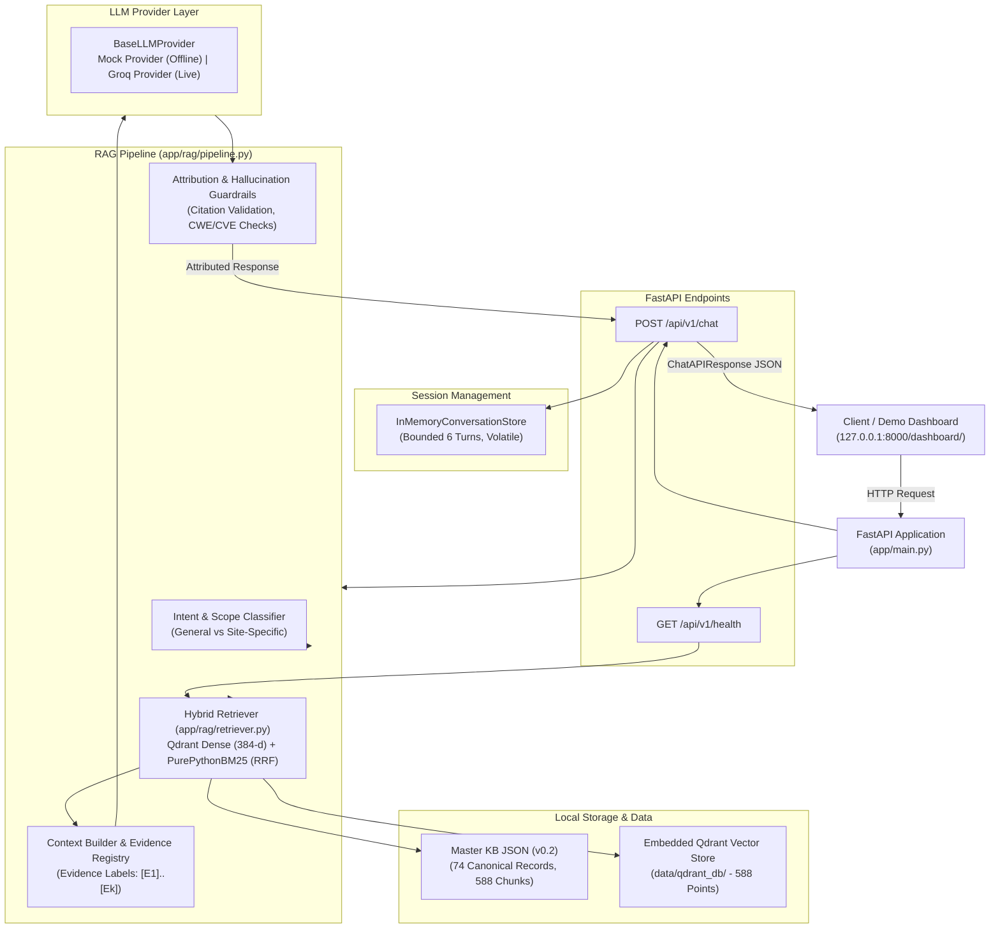

# AI Cybersecurity Assistant

A production-structured, retrieval-augmented generation (RAG) assistant for defensive cybersecurity and web-application vulnerability intelligence.

The assistant provides grounded, evidence-backed answers to general cybersecurity questions, vulnerability mechanisms, detection methodologies, and defensive remediation strategies using a curated vulnerability Knowledge Base.

---

## 1. Project Overview & Goals

- **Knowledge-Grounded Intelligence:** Answers general software security and vulnerability questions strictly from a verified, curated Knowledge Base rather than relying on ungrounded model training weights.
- **Strict RAG Architecture:** Employs dense vector similarity search combined with sparse BM25 keyword matching (reciprocal rank fusion), dynamic evidence injection, and deterministic post-generation attribution guardrails.
- **No Model Training:** The system does not fine-tune or train an LLM; it grounds off-the-shelf instruction models via constrained context injection.
- **Bilingual Support:** Full bilingual retrieval and answer generation in English and Arabic (`en` and `ar`).
- **Defensive Focus:** Tailored exclusively for defensive remediation, vulnerability comprehension, and secure coding practices.

---

## 2. Scope & System Architecture

### Architectural Boundaries
- **Independent Standalone Service:** This service operates entirely independently of any vulnerability scanner tools. It does not probe live hosts, execute web scans, or parse dynamic scanner output.
- **Active Scenario Scope:** The Knowledge Base covers the **119 Active scanner scenarios**, normalized and consolidated into **74 canonical vulnerability records** and **588 indexed semantic chunks**. *(Important: The 119 active scanner scenarios are represented through these 74 canonical records; no separate scenario-by-scenario mapping has been verified, and no individual one-to-one coverage is claimed).*
- **Deferred Scenarios Excluded:** The 74 Deferred scanner scenarios are explicitly out of scope and excluded from this component.
- **Grounding vs. Diagnosis:** Generic Knowledge Base data cannot verify whether a specific live target URL or website is vulnerable. For site-specific queries (e.g., *"Is my site https://example.com vulnerable to SQL injection?"*), the assistant detects the site-specific intent, applies a mandatory educational disclaimer, and provides general defensive principles under the `site_qualified` grounding status.

### System Architecture Diagram



---

## 3. Separation from Vulnerability Scanner

The AI Cybersecurity Assistant is intentionally decoupled from the scanner component:
- **No Shared Execution:** It does not invoke, control, or monitor vulnerability scanning operations.
- **No Live Probing:** It never sends attack payloads, fuzzing inputs, or active HTTP probes to any remote system.
- **Knowledge Base Independence:** The assistant's Knowledge Base is curated from defensive security standards (OWASP, CWE, NIST), not derived from real-time scanner logs.
- **Clear Responsibility Boundary:** The scanner identifies potential runtime findings; this assistant provides conceptual explanations, architectural impact analysis, detection methodologies, and code-level remediation advice.

---

## 4. Requirements & Windows Setup Instructions

### Environment Prerequisites
- **Operating System:** Windows 10 / Windows 11 (tested on Windows PowerShell).
- **Python:** Python 3.13.x 64-bit (specifically verified on Python 3.13.9 64-bit). Compatibility with earlier Python versions (3.10–3.12) has not been verified with the current pinned binary dependency set (`requirements-phase3.txt`).
- **Hardware:** Standard CPU execution (Sentence Transformers and embedded Qdrant run locally on CPU).

---

## 5. Virtual Environment & Dependency Installation

In a Windows PowerShell terminal, execute the following commands:

```powershell
# 1. Navigate to project root
cd "D:\AI Cybersecurity Assistant"

# 2. Create Python virtual environment
python -m venv .venv

# 3. Activate virtual environment
.\.venv\Scripts\Activate.ps1

# 4. Upgrade pip
python -m pip install --upgrade pip

# 5. Install Phase 3 core retrieval dependencies (pinned)
pip install -r requirements-phase3.txt

# 6. Install Phase 4 service and provider dependencies
pip install -r requirements-phase4.txt
```

---

## 6. Environment Configuration

Configuration is managed via Pydantic Settings in `app/config.py` and loaded from `.env`.

### Setting Up `.env`
Create a `.env` file by copying `.env.example`:

```powershell
Copy-Item .env.example .env
```

> [!WARNING]
> **Do Not Overwrite Existing Credentials:** If a `.env` file already exists with configured settings or a valid `GROQ_API_KEY`, do **not** run `Copy-Item`, as doing so will overwrite your existing configuration with empty template values.

### Configuration Variables

| Variable | Default Value | Description |
|:---|:---|:---|
| `PROJECT_NAME` | `"AI Cybersecurity Assistant"` | Service display name |
| `VERSION` | `"0.2.0"` | Current application semantic version |
| `MASTER_KB_PATH` | `"data/master/ai_security_vulnerability_kb_master_v0.2.json"` | Relative path to Master KB JSON |
| `BASELINE_KB_SHA256` | `"d59af97e75dce8540f5dfaf1ba2d4e4afbcfe99c2ac697779bb5e9c6c0e99471"` | Baseline checksum for integrity verification |
| `QDRANT_STORAGE_PATH` | `"./data/qdrant_db"` | Filesystem directory for embedded Qdrant |
| `QDRANT_COLLECTION_NAME` | `"cybersecurity_kb_chunks"` | Qdrant collection name |
| `EMBEDDING_PROVIDER` | `"local"` | Embedding mode (`"local"` using Sentence Transformers) |
| `EMBEDDING_MODEL_NAME` | `"sentence-transformers/paraphrase-multilingual-MiniLM-L12-v2"` | 384-dimensional multilingual model |
| `LLM_PROVIDER` | `"mock"` | Provider mode: `"mock"` (offline default) or `"groq"` |
| `GROQ_API_KEY` | `""` | Groq API Key (required only when `LLM_PROVIDER="groq"`) |
| `GROQ_MODEL` | `"llama-3.3-70b-versatile"` | Active model identifier (e.g. `llama-3.3-70b-versatile` or `openai/gpt-oss-120b`) |
| `GROQ_TEMPERATURE` | `0.1` | Low temperature for grounded generation |
| `GROQ_MAX_TOKENS` | `2048` | Maximum completion token budget |
| `GROQ_TIMEOUT_SECONDS`| `20.0` | Client timeout per API call |
| `GROQ_MAX_RETRIES` | `2` | Automatic retry budget on rate limits / network blips |

> [!IMPORTANT]
> **Secret Hygiene:** `.env` is permanently excluded from version control via `.gitignore`. Never commit, share, print, or expose API keys.

---

## 7. How to Build & Index the Master KB

The local embedded Qdrant database directory (`data/qdrant_db/`) is intentionally excluded from Git tracking via `.gitignore` to prevent binary bloat and platform lock conflicts.

### First-Time Indexing for Fresh Clones
After cloning the repository and setting up your virtual environment, generate the local Qdrant vector index from the Master KB:

```powershell
# Index Master KB chunks into local Qdrant (588 chunks)
python scripts/index_kb.py
```

Once indexed, the vector store is ready for evaluation and testing. Re-running `python scripts/index_kb.py` without `--recreate` is idempotent (upserts without creating duplicates).

### Recreating the Index
To drop and recreate the collection from scratch:

```powershell
# Complete recreation (drops existing collection before re-indexing)
python scripts/index_kb.py --recreate
```

> [!WARNING]
> **Destructive Operation:** Running `python scripts/index_kb.py --recreate` explicitly deletes (`delete_collection`) the active `cybersecurity_kb_chunks` collection from `data/qdrant_db/` before re-indexing. Do not run this command during active evaluation or server operation.

### Indexing Safety & Idempotency
- **Chunk UUID Determinism:** Every chunk ID is deterministically mapped to a UUIDv5. Re-running indexing without `--recreate` cleanly upserts without creating duplicate entries.
- **Master KB Immutability:** `scripts/index_kb.py` performs automated SHA-256 integrity verification before and after execution. The Master KB JSON is opened strictly read-only and is never altered.

---

## 8. How to Run the API & Demo Dashboard

Launch the FastAPI application using Uvicorn bound to `127.0.0.1`:

```powershell
uvicorn app.main:app --host 127.0.0.1 --port 8000
```

Once running:
- **Interactive OpenAPI Documentation (Swagger UI):** [http://127.0.0.1:8000/docs](http://127.0.0.1:8000/docs)
- **Alternative API Documentation (ReDoc):** [http://127.0.0.1:8000/redoc](http://127.0.0.1:8000/redoc)
- **Demo Dashboard:** [http://127.0.0.1:8000/dashboard/](http://127.0.0.1:8000/dashboard/)
- **Root Informational Endpoint:** [http://127.0.0.1:8000/](http://127.0.0.1:8000/)

---

## 9. Mock vs. Groq Provider Configuration

The service supports two interchangeable LLM backends configured in `.env`:

### 1. Mock Provider (`LLM_PROVIDER="mock"`) — Default
- **Network Requirement:** Zero internet connection required (100% offline).
- **Billing:** Zero cost, no API keys.
- **Behavior:** Returns deterministic, synthesized response templates referencing retrieved evidence labels `[E1]..[Ek]`.
- **Use Case:** Local integration testing, offline regression verification, and UI workflow validation.
- **Dashboard Notice:** The demo dashboard displays a prominent amber warning banner indicating Mock Mode is active.

### 2. Groq Provider (`LLM_PROVIDER="groq"`)
- **Network Requirement:** Outbound HTTPS access to `api.groq.com`.
- **Credentials:** Requires a valid `GROQ_API_KEY`.
- **Supported Models:** Evaluated on `openai/gpt-oss-120b` and `llama-3.3-70b-versatile`.
- **Attribution Guardrails:** Live model outputs are strictly verified post-generation:
  - All citations (`[E1]`, `[E2]`, etc.) must map to chunks actually present in the prompt.
  - Extracted CWE and CVE identifiers are cross-checked against injected chunks.
  - Truncated answers or attribution failures fall back to safe deterministic messages.

---

## 10. API Endpoints, Contracts & Grounding Statuses

### Health Inspection Endpoint
- **Method / Path:** `GET /api/v1/health` (also aliased at `GET /health`)
- **Behavior:** Lightweight, non-billable local check verifying KB file integrity and Qdrant connectivity.
- **Response Example:**
  ```json
  {
    "status": "healthy",
    "version": "0.2.0",
    "master_kb_checksum_verified": true,
    "vector_store_status": "ready",
    "indexed_point_count": 588,
    "llm_provider": "mock",
    "llm_configured": true
  }
  ```

### Chat Endpoint
- **Method / Path:** `POST /api/v1/chat`
- **Request Schema:**
  ```json
  {
    "message": "What is SQL injection, and what are two defensive ways to prevent it?",
    "conversation_id": "optional-session-id"
  }
  ```
  *Note:* Omitted `conversation_id` generates a new UUID4 session. Non-empty string must match `^[a-zA-Z0-9_\-]{1,64}$`.

- **Response Schema Example:**
  ```json
  {
    "answer": "SQL injection occurs when untrusted user input is directly concatenated into database queries [E1]. To mitigate this vulnerability, use parameterized queries (prepared statements) and input validation [E2].",
    "grounded": true,
    "grounding_status": "grounded",
    "is_site_specific": false,
    "language": "en",
    "retrieved_sources": [
      {
        "chunk_id": "sql-injection_overview_and_mechanism",
        "vulnerability_id": "sql-injection",
        "name": "SQL Injection",
        "section": "overview_and_mechanism",
        "cwe": ["CWE-89"],
        "owasp": ["A03:2021-Injection"],
        "score": 0.884,
        "metadata": {}
      }
    ],
    "cited_sources": [
      {
        "chunk_id": "sql-injection_overview_and_mechanism",
        "vulnerability_id": "sql-injection",
        "name": "SQL Injection",
        "section": "overview_and_mechanism",
        "cwe": ["CWE-89"],
        "owasp": ["A03:2021-Injection"],
        "score": 0.884,
        "metadata": {}
      }
    ],
    "retrieval_latency_ms": 14.5,
    "llm_latency_ms": 0.8,
    "total_latency_ms": 15.3,
    "conversation_id": "8a3d4679-b1d5-470f-90e6-5b48154be2e0"
  }
  ```

### Operational Grounding Statuses

| Grounding Status | Definition & Behavior |
|:---|:---|
| `grounded` | Structural attribution passed: evidence retrieved, citations valid, identifiers verified against KB context. |
| `site_qualified` | Query targeted a specific system/URL; answer prepends diagnostic disclaimer with general KB advice. |
| `empty_retrieval` | Retrieval returned 0 chunks; deterministic refusal returned. |
| `insufficient_evidence` | Retrieved chunks lacked sufficient information or similarity; refusal returned. |
| `attribution_failed` | Generated answer cited invalid evidence labels or unsupported CWE/CVEs; fallback answer returned. |
| `incomplete_truncated` | Model hit token limits (`finish_reason == "length"`); truncated text discarded and fallback provided. |

---

## 11. Running Automated Tests

All tests run 100% offline with zero external network requests using `LLM_PROVIDER="mock"`.

### Run the Full Offline Test Suite (192 Tests)

```powershell
python -m pytest -q
```
*Expected output:* `192 passed in ~35s`.

### Run Focused Subsystem Tests

```powershell
# Vector retrieval, BM25 fusion, and concurrency thread-safety tests (19 tests)
pytest tests/test_retrieval.py -v

# FastAPI endpoints, input validation, and Qdrant lifecycle tests (19 tests)
pytest tests/test_api.py -v

# RAG context construction and evidence label tests (12 tests)
pytest tests/test_context_builder.py -v

# Citation verification and attribution guardrail tests (20 tests)
pytest tests/test_rag_pipeline.py -v

# Stage C2 bounded offline matrix tests (32 tests)
pytest tests/test_stage_c2_offline.py -v

# Arabic RAG quality, intent classification, and bilingual handling (21 tests)
pytest tests/test_arabic_rag_and_intent.py -v

# Acronym, distractor boundary, and noise evaluation tests (20 tests)
pytest tests/test_acronym_and_distractor_evaluation.py -v

# Frontend dashboard serving, XSS prevention, and panel removal (10 tests)
pytest tests/test_dashboard.py -v
```

---

## 12. Current Limitations & Security Considerations

1. **Local Single-Process Deployment:**
   - The embedded Qdrant database uses local filesystem locking (`portalocker`).
   - The application must be run as a single Uvicorn worker process (`workers=1`). Concurrent access across multiple separate OS processes requires an external client/server Qdrant instance.
2. **Localhost Binding:**
   - The server must remain bound to `127.0.0.1`. Do not bind to `0.0.0.0` or expose the service directly to public networks.
3. **Volatile Conversation Memory:**
   - Multi-turn conversation state is maintained in-process (`InMemoryConversationStore`). State is ephemeral, volatile, and reset upon server restart.
   - Sessions are capped at 6 turns and 1,000 active conversations with LRU eviction.
4. **No Authentication / Multi-Tenant Isolation:**
   - The API does not enforce user authentication or role-based access control. Session IDs provide 128-bit unguessability for local demonstrations, not cryptographically authenticated tenancy.
5. **Demo Dashboard:**
   - The dashboard hosted at `/dashboard/` is an evaluation tool. It implements safe DOM manipulation (`textContent`), but is not a hardened multi-user enterprise frontend.

---

## 13. Teammate Integration Reference

For detailed integration guides, error response formats, and payload structures for frontend and teammate integration, refer to:

👉 **[`API_INTEGRATION.md`](API_INTEGRATION.md)**

---

## 14. Verified Project Status

| Metric / Checkpoint | Verified Status |
|:---|:---|
| **Master Knowledge Base File** | `data/master/ai_security_vulnerability_kb_master_v0.2.json` |
| **Master KB SHA-256 Hash** | `d59af97e75dce8540f5dfaf1ba2d4e4afbcfe99c2ac697779bb5e9c6c0e99471` (Bit-for-bit match) |
| **Canonical Vulnerability Records** | 74 records |
| **Active Scanner Scenarios Covered** | 119 scenarios (represented through 74 canonical records; no separate 1:1 mapping verified) |
| **Indexed Semantic Chunks** | 588 points in Qdrant (`cybersecurity_kb_chunks`) |
| **Automated Regression Test Suite** | 192 passed / 0 failed (100% offline) |
| **Completed Validation Stages** | Phase 1–4, Stage C1, Stage C2-A, Stage C2-B, Stage C3-A through C3-H |
